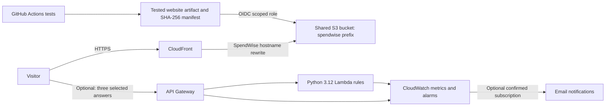

# SpendWise

SpendWise is a mindful-spending browser demo and cloud engineering portfolio project. It demonstrates a small application delivered through S3 and CloudFront, with an optional API Gateway and Python Lambda insight service.

The demo uses a sample purchase. It does not buy products, change shopping carts, schedule reminders, detect emotions, or store reflection history. The production mobile architecture shown on the portfolio pages is a separate design.

## Run locally

Use Python 3.12 for the Lambda-compatible test environment and Node.js 22 for the browser tests.

```sh
python3 -m venv .venv
source .venv/bin/activate
python -m pip install pytest pytest-cov cfn-lint
npm ci
npx playwright install chromium
python -m http.server 3000 --directory spendwise
```

Open <http://localhost:3000/demo.html>. The camera is optional and requires browser permission. The local rules work without an AWS account or network request. See `spendwise/js/demo-config.js` for the optional public API URL; it is configuration, not a secret.

In another terminal, run checks from the repository root:

```sh
.venv/bin/python -m pytest -q
.venv/bin/cfn-lint -i W3002 -t infrastructure/template.yaml infrastructure/github-oidc.yaml infrastructure/budget.yaml
npm test
node --check spendwise/js/demo.js
node --check spendwise/js/navigation.js
```

Playwright starts its own local server on port 8765. The manual preview uses port 3000. No AWS credentials are required for these tests. Template lint ignores only W3002: the local Lambda code path is intentionally resolved by `aws cloudformation package` before deployment.

## Repository map

| Path | Purpose |
| --- | --- |
| `spendwise/` | Buildless portfolio pages, demo, CSS and JavaScript |
| `infrastructure/lambda/nudge.py` | Ordered rules and validated JSON API handler |
| `infrastructure/template.yaml` | API Gateway, Lambda, logging, throttling and alarms |
| `infrastructure/budget.yaml` | Optional account-wide monthly budget notifications |
| `infrastructure/github-oidc.yaml` | Scoped website deployment role and OIDC trust |
| `.github/workflows/` | Test, artifact deployment and guarded website rollback |
| `scripts/` | Release manifest, rollback provenance and public-byte checks |
| `tests/` | API, rule parity, delivery and browser regression tests |

## Architecture and delivery



Only `feeling`, `planned`, and `wait` are sent to the optional API. The reason and camera frames stay in the browser. CORS is a browser-origin control, not authentication. The public endpoint is intended for non-sensitive sample answers.

CI tests the application, validates templates, and packages the website. Deployment uploads that artifact to `/spendwise/`, waits for cache invalidation, and compares public bytes. Pull requests run checks without deploying. Rollback accepts a successful main-branch release artifact from the same repository and checks its revision and file hashes before uploading it.

Shared website hosting, DNS and certificates are existing resources and are not recreated by the API template. The website workflow does not deploy the Lambda stack. See [the operations guide](docs/operations.md) for cloud setup, release and recovery steps, costs and limits.

## Demo design

The interactive app uses the same iPhone-proportioned frame as the UX studies, always-visible project navigation, readable stage labels, Back navigation with retained answers, and equally styled decision buttons. The navy/blue palette is shared with the portfolio. Design explanations expand separately from the reflection, with cloud engineering details below it.

See [the approved design plan](docs/app-design-plan.md) for layout, interaction and colour decisions. Browser checks cover enlarged text and representative contrast states; real screen-reader verification remains separate.

## Verification and portfolio evidence

See [the portfolio audit](docs/portfolio-audit.md) for the remaining-page findings and fixes. See [verification evidence](docs/verification.md) for current results and the remaining hosted demonstrations. The [website release](https://github.com/abdullahi-17/spendwise/actions/runs/43931525335) passed hosted checks, published the tested artifact, and verified public bytes. A live demo smoke check also passed. The optional Lambda API is not enabled; alert delivery and rollback still need demonstrations. See [the release record](docs/releases/2026-11-16.md).
